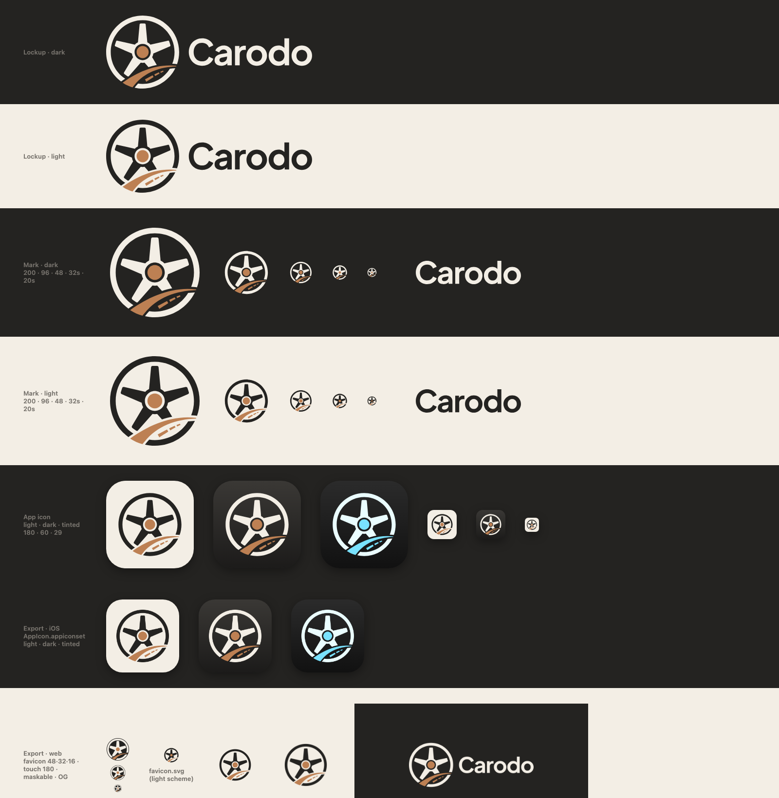

# Carodo brand: mark, wordmark, lockup

The **mark** is a five-spoke wheel inside an outer ring. A journey crosses its lower half: a copper swoosh and a dashed lane that runs into the distance. The **wordmark** is "Carodo" set in Plus Jakarta Sans Bold and converted to outlines. The **lockup** is the mark and the wordmark side by side.

The geometry was traced from the brand board [`brand-board.png`](brand-board.png) and redrawn as clean parameters. `source/` is the only source of truth: every file in `svg/` and `preview/` is generated, so never edit those by hand.



## Folder

| Path | What it is |
|---|---|
| `source/mark.py` | All geometry parameters → `geometry.json` (the primitive shapes) |
| `source/export.swift` | `geometry.json` + `wordmark.json` → every asset. CoreGraphics boolean operations flatten the mark into plain filled paths (no masks, strokes or arcs), then it writes SVG, PNG, ICO and the manifests. macOS only, no extra dependency. |
| `source/wordmark.swift` | Outlines the wordmark from the font with CoreText → `wordmark.json` |
| `source/geometry.json`, `wordmark.json` | Generated intermediates, checked in so `export.swift` runs without Python or the font |
| `source/build.sh` | Runs all of the above, then renders `preview/*.png` with headless Chrome |
| `source/preview.html`, `vs-board.html` | Preview sheets; open them in a browser |
| `svg/` | Flattened SVG masters (table below) |
| `export/ios/AppIcon.appiconset/` | The iOS app icon, ready to drop into an asset catalog |
| `export/ios/LaunchMark.imageset/`, `LaunchBackground.colorset/` | The static launch screen: the mark's wheel alone, whole (no journey, no cuts), in the mark's 120 pt box (charcoal / ivory wheel), and the Ivory / Charcoal background |
| `export/ios/CarodoMarkGeometry.swift` | The mark as SwiftUI paths in animatable parts (ring, spokes, knockout, hub, swoosh, lane dashes) and the wordmark, for the onboarding ([`../onboarding.md`](../../../carodo-ios/docs/specs/onboarding.md)) |
| `export/icon-composer/` | The icon's layers as separate SVGs, for an Icon Composer `.icon` (iOS 26 Liquid Glass) |
| `export/web/` | Favicons, touch and PWA icons, OG image, `site.webmanifest`, `head.html` |
| `preview/overview.png` | Lockups, the mark at every size, the app icons, and the iOS and web exports |
| `preview/vs-board.png` | The board, the mark, and the two overlaid at the same scale |

## Assets

### `svg/`: masters

| File | Use |
|---|---|
| `carodo-mark-on-dark.svg` / `-on-light.svg` | The mark, 48 px and up. Dark background: ivory wheel. Light background: charcoal wheel. The journey is always copper. |
| `carodo-mark-small-on-dark.svg` / `-on-light.svg` | 32 px and smaller. Heavier strokes and a wider gap; no lane dashes and no hub gap. |
| `carodo-mark-mono.svg`, `carodo-mark-small-mono.svg` | One colour (`currentColor`): templates, print, embossing. The hub is drawn as a ring. |
| `carodo-wordmark-on-dark/-on-light/-mono.svg` | The wordmark alone; the viewBox is tight to the ink |
| `carodo-lockup-on-dark/-on-light.svg` | Mark + wordmark: web header, share page, splash, slides |
| `appicon-light/-dark/-tinted.svg` | Vector versions of the three app icons, 1024² |

### `export/ios/AppIcon.appiconset/`

These are 1024² single-size icons (Xcode 14+). Xcode derives every other size.

| File | Appearance | Notes |
|---|---|---|
| `AppIcon.png` | Any (light) | Ivory background, **no alpha channel**: the App Store rejects an icon with alpha |
| `AppIcon-Dark.png` | `luminosity: dark` | Transparent background; iOS supplies its dark backdrop |
| `AppIcon-Tinted.png` | `luminosity: tinted` | Greyscale (white wheel, grey journey); iOS applies the user's tint |

The app uses it from `carodo-ios/Carodo/Resources/Assets.xcassets/AppIcon.appiconset`, with `ASSETCATALOG_COMPILER_APPICON_NAME: AppIcon` set in `project.yml`. After changing the mark, run `sh source/build.sh`, then copy the folder over the app's copy:

```sh
cp export/ios/AppIcon.appiconset/* ../../../carodo-ios/Carodo/Resources/Assets.xcassets/AppIcon.appiconset/
cp -R export/ios/LaunchMark.imageset export/ios/LaunchBackground.colorset ../../../carodo-ios/Carodo/Resources/Assets.xcassets/
cp export/ios/CarodoMarkGeometry.swift ../../../carodo-ios/Carodo/DesignSystem/Brand/
```

### `export/web/`

| File | Use |
|---|---|
| `favicon.ico` | 16/32/48, the small mark on a charcoal disc, so it reads on both light and dark tabs |
| `favicon.svg` | The small mark; the wheel switches to ivory under `prefers-color-scheme: dark` |
| `apple-touch-icon.png` | 180², the light app icon (opaque; iOS rounds the corners) |
| `icon-192.png`, `icon-512.png` | PWA icons |
| `icon-maskable-512.png` | PWA maskable icon: the ring sits inside the 80 % safe circle |
| `og-image.png` | 1200 × 630 share image: the lockup on charcoal |
| `site.webmanifest`, `head.html` | The manifest and the `<head>` tags to paste; the files go at the site root |

Colours are the `CarodoColor` tokens ([design-system.md](../../../carodo-ios/docs/design-system.md)):

| Token | Hex |
|---|---|
| charcoal | `#242321` |
| copper | `#BD8053` |
| ivory | `#F3EEE5` |
| stone | `#77736D` |

## How to change something

1. Edit the parameter in `source/mark.py`. They all sit in `FULL`, `SMALL` and `LOCKUP` at the top.
2. Run `sh source/build.sh`. This regenerates every SVG, PNG and export, then the previews.
3. Check `preview/overview.png` at every size, on dark **and** light, and `preview/vs-board.png` if the change touches the traced shape.
4. Note the change and why in the decision log at the bottom of this file.

| To change | Parameter (`FULL` unless noted) | Watch out for |
|---|---|---|
| Ring weight | `ring_w`, plus `ring_r` = 46 − `ring_w`/2 | Keep the outer edge at 46, or the icon and lockup sizes shift |
| Spoke length / width / tips | `spoke_r1`, `spoke_w` = (width at r 0, change per unit r), `tip_round` | The tips need about 4 units of clearance from the ring's inner edge |
| Hub | `cap_r` (copper), `hub_gap_r` (dark gap), `hub_r` (ivory ring) | Keep the ivory ring thicker than the gap, or the hub reads as a dark donut at small sizes |
| Swoosh shape | `upper`, `lower` (cubic Bézier control points), `cut_r` | The 4–5 o'clock spoke is cut by `upper`: raising the swoosh hides it |
| Lane / dashes | `lane` (centre line), `dashes` (ranges 0 = near → 1 = far), `lane_w` (thickness near → far) | The dashes must stay clear of the ring's inner edge (r 40.2) by more than `gap`. Lengths, gaps and thickness should all shrink toward the tip, or the depth is lost. |
| Gap between crossing parts | `gap` | Below ~2 it closes up at small sizes |
| Small version | `SMALL` | Check it at 16, 20 and 32 px |
| Lockup spacing | `LOCKUP.cap_height`, `LOCKUP.gap` (shares of the ring diameter) | — |
| App icon padding | `ICON_SCALE` (mark size = 100 × scale of 1024) | Apple's icon grid: keep the ring inside ~80 % of the canvas |
| Web exports (sizes, OG layout, manifest) | the "Assets" section at the end of `source/export.swift` | The maskable icon must keep the ring inside the 80 % circle |
| Colours | `CHARCOAL`, `COPPER`, `IVORY` | They must match `CarodoColor` in the iOS app |

### Changing the wordmark (text, weight, letter spacing)

The font is not checked in. Download Plus Jakarta Sans (SIL Open Font License) from
`https://github.com/google/fonts/raw/main/ofl/plusjakartasans/PlusJakartaSans%5Bwght%5D.ttf`, then:

```sh
swift source/wordmark.swift PlusJakartaSans[wght].ttf source/wordmark.json Carodo 700 -0.03
#                            font                       output                text   weight tracking
sh source/build.sh
```

Weight 700 makes the letter stems (0.064 D) as heavy as the ring (0.063 D). Tracking −0.03 matches the board's wordmark width (4.66 × the cap height).

## Geometry (100 × 100 grid, centre 50,50, outer ring radius 46)

| Part | Value | Source |
|---|---|---|
| Outer ring | r 40.2 → 46 (5.8 thick) | measured from the board |
| Spokes | 5 at 72°, top one up; 11.6 wide at the hub → 7.4 at the tip; tips at r 36; square tips with 1.5 corners | measured from the board, then made even (the board's spokes are a few degrees off) |
| Hub | copper r 7.6 · dark gap to 10.2 · ivory ring to 13.6 | board 7.2 / 10.5 / 13.5, tuned for small sizes |
| Swoosh | two cubic edges fitted to the board (max error 0.5); left end cut along r 46.2; narrow tip at the ring's right edge | traced |
| Lane | 3 dashes along the board's dash line, moved 18 % toward the swoosh; thickness 3.4 → 1.2 | the swoosh tip is the vanishing point |
| Gap | 2.3 (small version 3.2) | |
| Lockup | cap height 0.364 D, mark-to-text gap 0.132 D, cap height centred on the wheel | measured from the board |

## Rules

- **Flat colours only** in the mark and the app icon. iOS 26 (Liquid Glass / Icon Composer) adds its own depth, and the dark, tinted and mono variants cannot carry a gradient. A gradient "expressive" version may be made for marketing (web hero, App Store, OG image), never for the icon.
- **Copper is the accent.** It is used for the journey and the hub, never for the ring or the spokes.
- **Pick the variant by background.** Use the ivory wheel on dark and the charcoal wheel on light. Never put the mark on photos or busy maps without a solid backdrop.
- **App UI type** stays SF with text styles, for Dynamic Type. Plus Jakarta Sans is only used inside the outlined wordmark; no font is bundled in the app.
- **Clear space** around the mark and the lockup is at least the hub diameter (≈ 0.3 D).

## Decision log

- **2026-11-02: mark locked.** Traced from the board and regularised. The lane has 3 dashes in perspective instead of the board's 2; with only 2 there is no rhythm, so the eye reads no depth. The 4–5 o'clock spoke stops at the swoosh, as on the board. We tried letting it run under the road or into the ring, but either way it broke into fragments around the dashes. The hub was tuned (7.2/10.5/13.5 → 7.6/10.2/13.6) so it reads at 29–48 px.
- **2026-11-02: wordmark.** Plus Jakarta Sans at 700, not the board's label "SemiBold". The board's lettering is visibly heavier (its stems are about 780 weight), and at 700 the stems match the ring's weight. Tracking −0.03.

- **2026-11-02: exports.** The masks are flattened with CoreGraphics boolean operations, so every SVG uses plain filled paths. Rendered against the masked originals, the two match except for 0.02 % of pixels, all of them anti-aliasing. The iOS icon ships as an asset catalog with light, dark and tinted 1024² images. XcodeGen's support for Icon Composer `.icon` files is unconfirmed, so the layers are exported for later.

- **2026-11-02: icon in the app.** `Assets.xcassets/AppIcon` was added to the iOS target, approved by the owner. `actool` compiles the any, dark and tintable renditions; build and the 57 unit tests pass.

## Still to do

- Check the dark and tinted icons on an iPhone home screen. The simulator did not render home-screen icons when this was set up.
- Optional: an Icon Composer `.icon` built from `export/icon-composer/` once Liquid Glass is in scope.
- Optional: the "expressive" gradient version for marketing.
