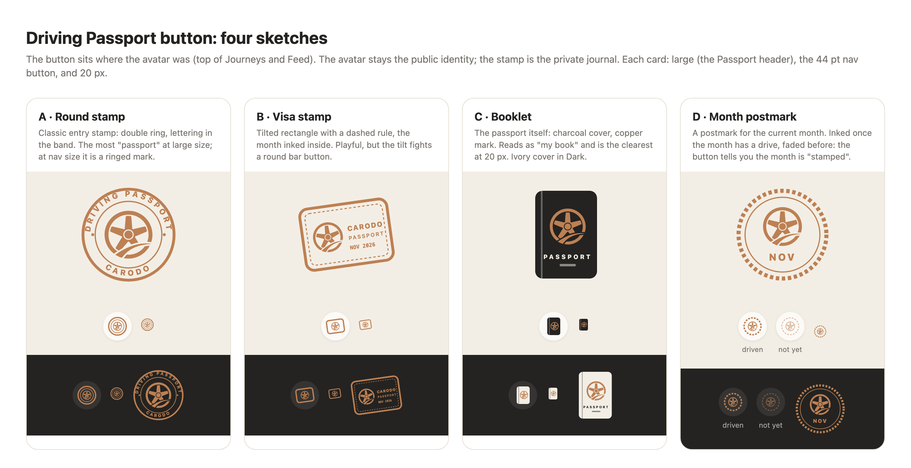

# Passport stamps

Status: in the app since 2026-11-03, drawn in SwiftUI from the mark
(`carodo-ios/Carodo/DesignSystem/Components/PassportMarks.swift`): A without lettering is the round
toolbar button on Journeys, A with lettering the Passport header, C the Passport's empty state.
Badges are stamps (carodo-ios ADR 0013, spec `../../drafts/achievements.md`): A for running totals,
B for kinds of drive, each also a 3D stamp in SceneKit when tapped; D stays the month strip.

`sketches.html` (rendered as `sketches.png`) explores four shapes made from the mark. They are hand-drawn
sketches, not generated assets: a shape that is chosen moves into `../brand/source/` and is
built by `build.sh`, like the app icon.

## One shape per role

The four shapes are kept as a family. Each has its own job, so together they read as one book:
the cover is the way in, and the stamps are inside.

| Shape | Role |
|---|---|
| **C · Booklet** | The Passport's **empty state**: a book the first drive opens. It was tried as the toolbar button and dropped: the only rectangle among the round iOS bar buttons. Never a badge. |
| **A · Round stamp** | Without lettering: the **button that opens the Driving Passport** on Journeys, in the bar's glass circle. With lettering: the "issued" stamp at the top of the Passport. As a badge: running totals (Road Miles, Journal Keeper, Faithful Car). On the Feed the avatar opens your Profile instead: the avatar is the public identity, the stamp the private journal. |
| **D · Month postmark** | One per month: inked when the month has a drive, faded before. A year's postmarks as a strip in the Passport. Not a badge, and not on the button: the faded state is lost at nav size. |
| **B · Visa stamp** | Badges for kinds of drive: Long Hauler, Explorer, Night Owl, Early Bird. |

A and B as badges: the tier in the impression (rings, ink density, copper foil at the top tiers),
never gold or silver; tapped, the stamp itself in 3D (a rubber die on a handle, SceneKit), turned
by a finger and pressed down to ink the page.

## Rules any badge must keep

- **No speed badges** (carodo-ios ADR 0007): no top speed, fastest drive or average-speed record,
  as for the Passport's highlights.
- **Place badges stay private.** A badge based on places (a new province, a mountain pass) shows
  only in the private Passport. If one ever reaches the Profile or a share card, it follows the
  privacy trim and private regions (carodo-ios `docs/specs/places.md`), and that needs a decision first.
- **GPS distance is not the odometer.** A distance milestone counts GPS distance and says so.
- **Computed on the device** from journeys, like the rest of the Passport. No new table until a
  badge spec says so.

## Before this becomes a feature

- A product decision that badges are wanted, weighed against record → replay → share
  (carodo-ios ADR 0001).
- A spec in `../../drafts/`: which badges, when they are earned, where they show, whether any are public.
- Final shapes in `../brand/source/`, checked at 20 px on light and dark.
